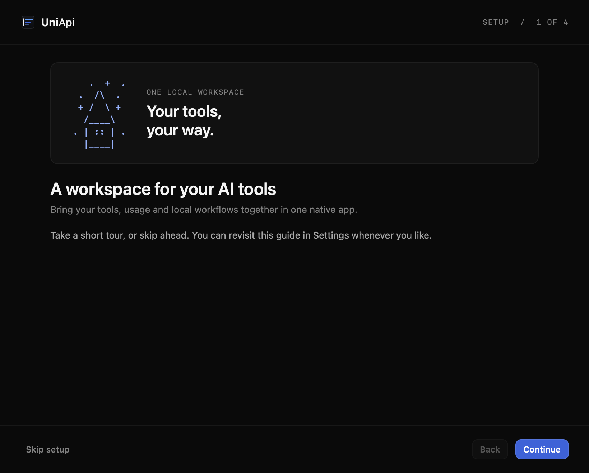
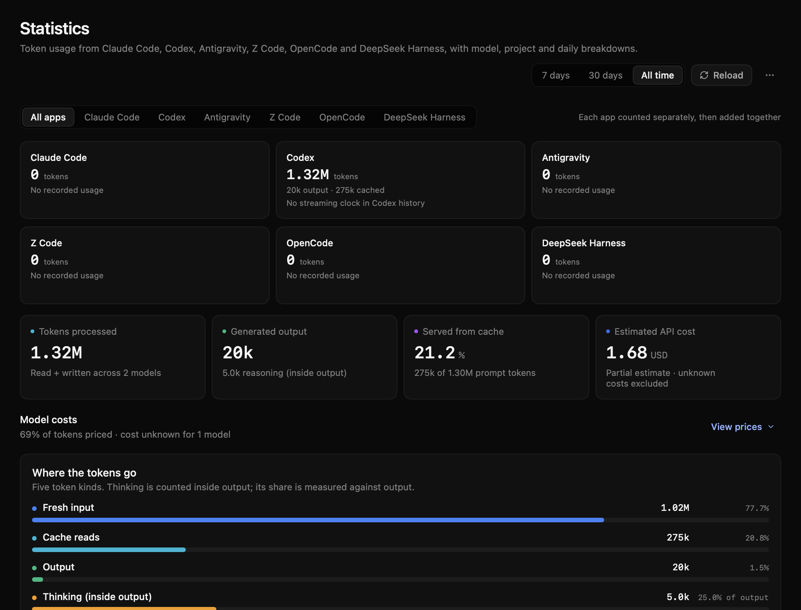
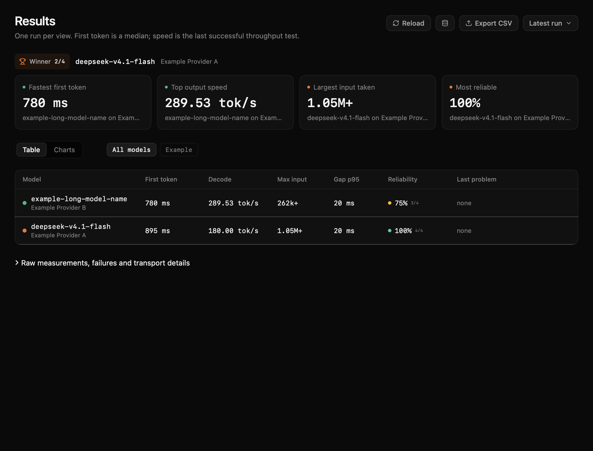

# UniApi

UniApi is a native macOS workspace for AI providers, coding tools, usage statistics and Mac utilities. Bring your own providers and accounts, choose the
integrations you need, and keep your work in one SwiftUI app.

**[Download the latest preview](https://github.com/Dodothereal/UniApi-public/releases/latest)** ·
[Installation](docs/INSTALL.md) · [Configuration](docs/CONFIGURATION.md) ·
[Validation](docs/VALIDATION.md) · [Performance observations](docs/PERFORMANCE.md)

## Before you install

The preview is for Apple Silicon (arm64). Setup and the navigation controls
described below require **0.1.12 or newer**; the release page identifies the
currently downloadable version. The app
targets macOS 14 and was validated on macOS 27.2 with Apple Silicon; physical
macOS 14 and Intel runtime behavior and universal builds remain unverified. A
thin Intel build has compiled and passed static header/signature checks. Source
builds require the pinned macOS 26.5 SDK and matching toolchain.

The preview is ad-hoc signed and **not notarized**. Ad-hoc signing does not verify the publisher. Fresh-user installation acceptance remains open; see
[installation and Gatekeeper guidance](docs/INSTALL.md). No account, provider
subscription or model weights are included.

## Install the preview

1. Download the latest release and its matching checksum. Compare the archive's
   SHA-256 with the checksum for that exact asset before extracting it. A
   checksum published alongside the archive does not independently establish
   its publisher.
2. Read the extracted package's `INSTALL.md`. For an existing installation,
   back up your configuration and data, finish queued and running jobs and
   coding turns, and use normal Quit to dismiss the presentation.
3. From the extracted package directory, inspect the read-only installation plan:

   ```sh
   ./install.sh --plan
   ```

4. If the plan admits installation and you choose to proceed, run:

   ```sh
   ./install.sh --install
   ```

Do not bypass a refusal or manually replace an existing app. The installer
checks ownership and active work and preserves existing data and providers;
read the [update and recovery details](docs/INSTALL.md#background-work-and-updates)
before changing an existing installation. Normal Quit keeps background work
running; closing a window does not prove services have stopped.

For source builds and separate runtime data, see [local development](docs/LOCAL-DEVELOPMENT.md).

## Your first five minutes

New, unconfigured installations offer a skippable single-screen welcome.
Choose a task—connect a model, explore usage, transcribe audio or look
around—adjust appearance and spacing, and open that page directly. Larger
windows show a small, non-interactive appearance preview. Opening welcome itself never signs you
in, downloads a model, changes hardware controls or changes routing. Existing
installations are not forced through setup; use **Settings > Show setup** to
replay it. If setup is interrupted, its appearance choices are retained and
the guide opens again at the next launch.

Once in the app, start with whichever part is useful:

1. **Home** gives you an overview and shortcuts. Explore without connecting a
   provider or installing a transcription model.
2. **Switcher** is where you can configure your own provider endpoint, model
   and credentials, or manage an optional coding-tool route.
3. **Statistics** reads supported local coding-tool usage stores; configure
   only the tools you use. **Speed** and **Arena** offer benchmarks and blind
   comparisons when you have configured suitable providers.
4. **Transcribe** can install an optional local Whisper model when you choose
   to use it. **Settings** lets you adjust appearance and other preferences.

Empty pages keep their next action beside the explanation. Speed links directly
to provider setup, Results links back to Benchmark, and Code uses the full
workspace for adding your first project. The free-test action remains secondary
and cannot start without a configured provider.

Provider requests, link retrieval, model downloads and optional summaries are
separate actions. Requests sent to a provider can incur charges under its terms.
See [Configuration](docs/CONFIGURATION.md) for the details.

## Providers and coding tools

UniApi starts with an empty provider template. Supply your own endpoint, model identifiers and credentials; vendor accounts, quotas and subscriptions are not
included. Formats, discovery and tool support vary, and discovering a model
does not prove that coding tools work with it. Test the action you intend to use.

Provider keys are stored locally in `providers.json` as plaintext by design.
Protect that file and its backups, and never attach them to a report. Optional
browser credentials belong in their dedicated credential store, not provider
key fields. See [provider configuration](docs/CONFIGURATION.md#providers).

### Codex and reasoning

API and subscription models can use UniApi's native Codex routing independently
of the optional Web GPT bridge. Connecting or restoring a route is an explicit,
guarded handoff; let active work finish and reload Codex's model metadata when
needed. Other coding integrations have their own setup and capabilities.

Reasoning choices depend on the provider and model. The documented CommandCode
DeepSeek route offers Low, High and Max, with High as its default. A stale
catalog can show different choices; discovery alone does not verify inference.
See [native routing](docs/CONFIGURATION.md#coding-tools-and-codex) and
[reasoning and catalog refresh](docs/REASONING.md).

## Local transcription

Transcribe uses the bundled Whisper CLI locally. Select **Install model** to
explicitly download the optional `large-v3-turbo` Q5 weights, approximately
574 MB. Opening the page does not download them. No vendor account, Wispr login
or cloud transcription credentials are required. **Remove model** removes the
weights when they are not in use.

WAV, MP3 and M4A use the native decoder; other formats may need ffmpeg, and
links require yt-dlp. Each job runs an owned Whisper child process and releases
model memory when it exits. Link retrieval uses the network, and an optional
provider summary sends text to the provider you select. See
[model setup and provenance](docs/CONFIGURATION.md#local-transcribe).

## Usage and costs

Statistics collects usage from supported local coding-tool stores. Provider/API costs are estimates based on the available pricing catalog: unpriced usage is
**unknown**, not free or zero. Provider invoices and subscription charges are
separate, and local history may be incomplete. Treat project names, transcripts
and usage records as private when sharing diagnostics.

The cost summary separates missing prices from empty usage. **View prices**
opens the model breakdown; partially priced usage is labeled as a partial
estimate, with unknown costs excluded rather than counted as zero.
Sources without any recorded usage show a simple empty state. Sources with
usage retain their streaming rate or an explanation of the missing clock.

Streaming speed is separate from response averages. New eligible Codex Responses
streams routed through UniApi can record a host send-completion clock, excluding
tool waits between requests and explicitly counted hidden reasoning tokens.
Historical records without that clock stay unmeasured; the app explains the gap
and offers response averages separately. No missing clock is replaced with zero.
A finished response keeps its measured clock if the client immediately closes
the connection. Replies that end before completion or lack enough arrival data
remain unmeasured.

## Settings and navigation

Settings diagnostics includes an opt-in five-minute performance recording for
page navigation and Statistics Reload. It saves timing and process counters
locally, without prompts, model names or credentials. See
[recording scope and limits](docs/SETTINGS.md#performance-recording).

Settings includes Light/Dark palettes with Original, Ocean, Forest and Plum
presets, plus color pickers and hex fields for text, highlights, surfaces and
other roles. Common colors appear first; advanced controls and contrast checks
are available without leaving the page. Spacing and motion are also adjustable.

Choose the launch page, restore the last visited page, and customize sidebar
visibility, order, width and badges. The sidebar editor supports drag targets
and a keyboard-accessible Move menu. Telegram setup walks through creating a
bot, explicitly finding destination chats, and saving optional delivery.
Home, Jobs and Settings stay available in the sidebar. See
[setup and navigation settings](docs/SETTINGS.md) for the controls and defaults.

## Explore the app

| Page | What it does |
| --- | --- |
| Home | Overview and shortcuts |
| Speed, Results, Prompts | Benchmark providers, compare history and manage prompts |
| Arena | Blind model comparisons and rankings |
| Switcher, Code | Configure providers and coding tools; work in coding sessions |
| Statistics | Review supported local coding-tool usage history |
| Transcribe | Run optional local Whisper transcription |
| Activity, Fan Control, Battery | Inspect activity and supported Mac hardware controls |
| Jobs, Settings | Follow background work and configure the app |

Jobs' **Clear old jobs…** action asks for confirmation before removing completed,
failed and cancelled entries older than seven days, including their job details
and logs. It keeps running/queued jobs, benchmark results and saved transcripts.
The Switcher's Codex tab also offers **Add provider** directly in its API-provider
section; route checks and model selection remain separate steps.

Statistics Reload checks changed history; warm, growing plain Codex files can
reuse bounded parser state after validating their old bytes. Strictly later,
unchanged-prefix appends can also retain committed old rows and their published
usage. Duplicates, retroactive changes, other source changes and uncertain cache
state use full assembly. Rebuild forces the full reader. These optimizations do
not imply instant whole-app Reload; see [performance scope](docs/PERFORMANCE.md).

Actions depend on your configured providers, installed tools and hardware.
Hardware controls may require compatible devices and an explicitly installed helper; a visible page does not guarantee device support.

## Screenshots

These are native views captured offscreen with empty fixture data. Setup uses
820×660 and 640×520 viewports; the page views use 1050×800 points.
The capture-only session bypasses normal background-service
startup. They illustrate views, not full-shell interaction, fresh-install
acceptance or compositor behavior. The [sanitized manifest](assets/screenshots/manifest.json)
records capture scope and image checksums.

**Welcome — Dark**

Choose a starting page, preview the appearance and spacing, then open that page
directly. The single-screen guide can be skipped or replayed from Settings.



[Welcome — Light](assets/screenshots/onboarding-light.png) ·
[Compact layout](assets/screenshots/onboarding-compact-dark.png)

**Statistics — sample usage, Dark**



[Sample usage — Light](assets/screenshots/stats-populated-light.png) ·
[Empty state — Dark](assets/screenshots/stats-dark.png) ·
[Empty state — Light](assets/screenshots/stats-light.png)

The sample contains two synthetic records. Its cost is a reference estimate,
not an operator's usage or billed spend.

**Results — sample comparison, Dark**



[Results — Light](assets/screenshots/results-light.png) ·
[Home — Dark](assets/screenshots/home-dark.png) ·
[Home — Light](assets/screenshots/home-light.png)

The comparison uses invented measurements, not provider performance claims.
The Home illustrations use empty dashboard summaries.

**Transcribe — Dark**


[Transcribe — Light](assets/screenshots/transcribe-light.png)

**Settings — Dark**


[Settings — Light](assets/screenshots/settings-light.png)

[Color customization](assets/screenshots/settings-theme-common-dark-1050x800.png) ·
[Sidebar editor](assets/screenshots/settings-sidebar-dark-1050x800.png) ·
[Telegram setup](assets/screenshots/settings-telegram-dark-1050x800.png)

## Help, validation and contributing

Start with [Installation](docs/INSTALL.md), [Configuration](docs/CONFIGURATION.md)
and [Local development](docs/LOCAL-DEVELOPMENT.md). Interface contributors should
also follow the [native design conventions](docs/DESIGN.md). When reporting a problem,
include the preview version, macOS version and architecture, and a sanitized
reproduction. Keep credentials, private histories and personal data out of reports.

Recorded validation includes **1,255 native tests with zero failures** for the
completed-response streaming correction, with separate native UI captures for
the layout refinements. Those checks apply to the recorded revisions and
scopes; they do not establish every device or integration.
See [validation and its limits](docs/VALIDATION.md).

Contributions are welcome: read [Contributing](CONTRIBUTING.md) and the
[agent guide](AGENTS.md), keep changes focused, and request independent review.
For vulnerability reports, follow the private reporting guidance in
[Security](SECURITY.md). See the [Changelog](CHANGELOG.md) for release history.

UniApi is licensed under [MIT](LICENSE). Bundled third-party components retain their own licenses; optional model weights and external tools have separate terms.
