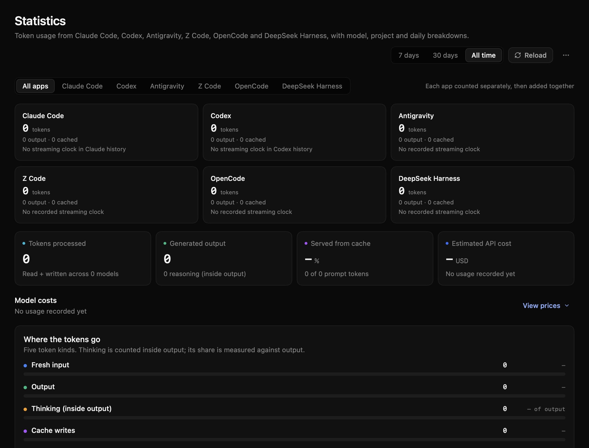
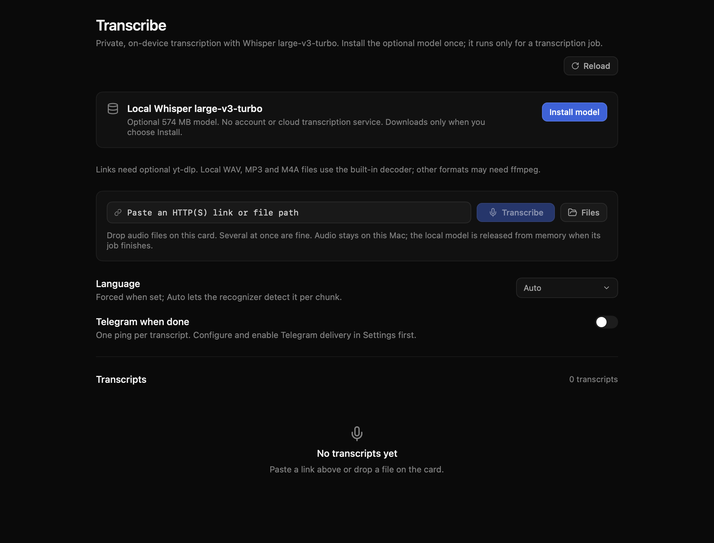
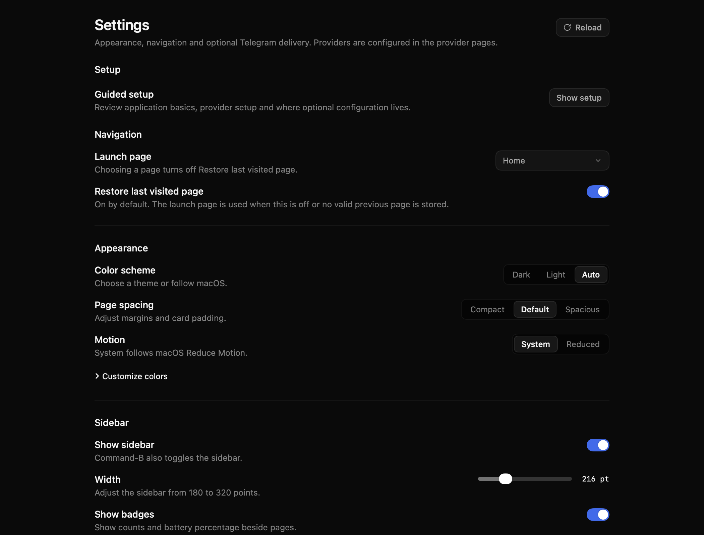

# UniApi

A native macOS workspace for AI providers, coding tools, usage statistics and Mac utilities. This repository is an MIT-licensed public preview built with SwiftUI and Swift. Providers and vendor accounts are supplied by you.

## Preview status

- Minimum deployment target: macOS 14. Validation has run on macOS 27.2 with Apple Silicon (arm64); macOS 14 runtime behavior has not been verified.
- Intel and universal builds remain pending actual build and runtime verification. The deployment target does not mean every Mac or macOS version has been tested.
- Source builds use the pinned macOS 26.5 SDK, the native SwiftPM build system, two compiler jobs and two backend threads.
- Preview 0.1.0 is arm64 only, ad-hoc signed and not notarized. All five executables target macOS 14 with SDK 26.5; there is no Intel or universal binary.
- Native Core/Presentation validation passed 1,176 tests with no failures, including the 50-test transcription/settings subset. Python packaging, installer and pricing fixtures passed 57 tests with no failures. These results do not establish every page, integration or device as verified.
- The final packaged app passed real local Whisper CLI checks for model installation, file transcription, cross-process lease protection, cancellation, removal and child-process cleanup. Six final page captures passed quiet checks and visual review. See [validation scope](docs/VALIDATION.md).

## Pages

The native app has 14 pages. Availability of individual actions depends on your configured providers, installed tools and hardware.

| Page | Purpose |
| --- | --- |
| Home | Overview and shortcuts |
| Speed | Provider benchmarks |
| Results | Benchmark history and comparisons |
| Prompts | Benchmark prompt management |
| Arena | Blind model comparisons and rankings |
| Switcher | Provider and coding-tool configuration |
| Code | Coding sessions and their workspaces |
| Statistics | Usage history from supported local coding-tool stores |
| Activity | Mac process activity |
| Fan Control | Fan monitoring and supported hardware controls |
| Battery | Battery status and supported charge controls |
| Transcribe | Optional local Whisper transcription with model install/remove controls |
| Jobs | Background work and progress |
| Settings | App configuration |

Hardware controls require compatible hardware and may require an explicitly installed helper. A visible page is not a guarantee of device support.

## Get started

Download: [0.1.0 preview release](https://github.com/Dodothereal/UniApi-public/releases/tag/v0.1.0). Follow [Installation](docs/INSTALL.md) for source builds, archive verification and explicit installation. Read [Configuration](docs/CONFIGURATION.md) before connecting providers or coding tools.

For one canonical checkout powering your local app while retaining private runtime data, see [Local development](docs/LOCAL-DEVELOPMENT.md).

UniApi runs native background services. Normal Quit hides the presentation and preserves background work; it does not stop the service owner. Updates and full shutdown must use the explicit owned-stop and installer admission mechanisms. Do not force a blocked update while jobs or coding turns are active.

## Local transcription

In Transcribe, choose **Install model** to download optional Whisper `large-v3-turbo` Q5 weights: 574,041,195 bytes (about 574 MB). **Remove model** deletes the installed weights when they are not in use. No account, Wispr login or cloud transcription credentials are required.

WAV, MP3 and M4A use the native audio decoder. Other formats may need optional ffmpeg; links require optional yt-dlp. Each transcription job runs the bundled Whisper CLI in a child process, loading one model for its audio chunks and releasing model memory when the child exits. There is no always-on Whisper process.

The app bundles the pinned upstream v1.9.4 CLI; the optional model weights are not included in the package. See [model provenance and setup](docs/CONFIGURATION.md#local-transcribe) and [explicit CLI commands](docs/CONFIGURATION.md#command-line-without-a-window) for model management and file transcription without a window. Optional provider-based summaries send text to the selected provider.

## Screenshots

Actual complete native page views in an offscreen viewport, empty fixture data; no full-shell or compositor claim. Each page retains its production scrolling container at 1050×800 points. The capture-only session bypasses normal background-service startup; these illustrations do not establish fresh-install or functional acceptance.

**Statistics — Dark**

[Statistics — Light](assets/screenshots/stats-light.png)

**Transcribe — Dark**

[Transcribe — Light](assets/screenshots/transcribe-light.png)

**Settings — Dark**

[Settings — Light](assets/screenshots/settings-light.png)

All six images were visually reviewed. The [sanitized manifest](assets/screenshots/manifest.json) records image checksums and capture scope.

## Contributing and security

See [Contributing](CONTRIBUTING.md), [Security](SECURITY.md) and the [Changelog](CHANGELOG.md). Keep reports and contributions free of credentials, personal transcripts and machine-specific data.

UniApi is licensed under [MIT](LICENSE). Bundled third-party components retain their own licenses; see the license references in [Contributing](CONTRIBUTING.md#licenses). Model weights and optional external tools have separate terms.
